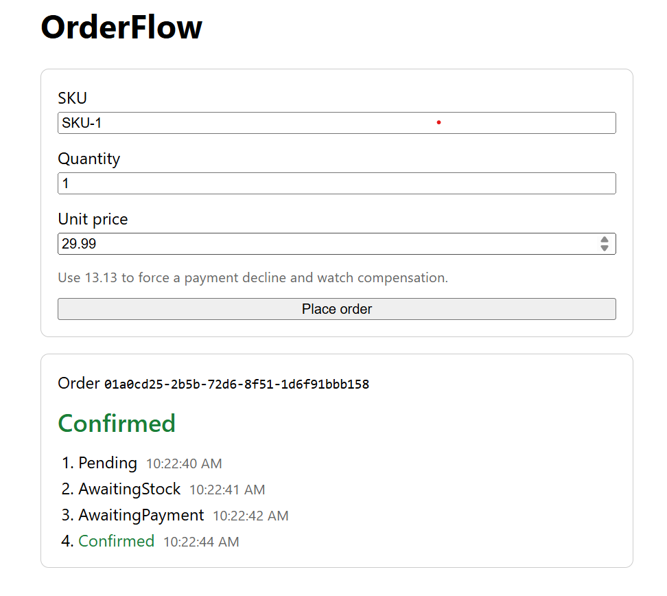

# OrderFlow

A small order system I built to practice distributed systems on Azure. It's four .NET services
(Order, Inventory, Payment, Notification) plus a YARP gateway, talking to each other over Kafka,
deployed to AKS behind API Management. There's an Angular front end too.

The main idea: placing an order has to reserve stock, take a payment and notify the customer, and
each of those lives in a different service with its own database. There's no distributed
transaction. Order runs a saga that keeps track of where each order is and undoes earlier steps
if a later one fails.



## How it fits together

```
client -> APIM -> ingress -> gateway -> order --(gRPC)--> inventory
                                          |
                                        Kafka (Event Hubs on Azure)
                                          |
                          inventory, payment, notification
                                                   |
                                         Service Bus -> Azure Function (email / sms)
```

- **Gateway** is the only thing exposed. It checks the user is signed in and routes by path.
- **Order** owns orders and the saga.
- **Inventory** reserves and releases stock. Order also asks it over gRPC whether stock is likely
  available, but that's just a hint. Actual reservations only happen through events.
- **Payment** charges and refunds (using a fake payment provider).
- **Notification** turns "order confirmed" into email/SMS tasks on a Service Bus topic, and a
  Function picks those up.

### Saga states

```
Pending -> AwaitingStock -> AwaitingPayment -> Paid -> Confirmed
any failure -> Compensating -> Cancelled
```

If payment fails after stock was reserved, the stock gets released. The saga only moves to
Cancelled after every compensation has been acknowledged. Each step has a deadline and a
background job times out sagas that get stuck.

### Messaging

- **Outbox:** events are saved in the same transaction as the business change and published by a
  background dispatcher, so a crash can't lose them.
- **Inbox:** consumers record `(MessageId, Consumer)` with a unique index, so redelivered messages
  are ignored.
- **Retries / DLQ:** a message that keeps failing goes to a `<topic>.dlq` topic after a few
  attempts.
- **Concurrency:** `rowversion` on the saga and on stock items.
- **Idempotency:** `POST /orders` takes an `Idempotency-Key` header, so a double click doesn't
  create two orders.

## Running locally

You need the .NET 10 SDK and Docker.

```bash
dotnet run --project src/Aspire/OrderFlow.AppHost
```

Aspire starts Kafka, RabbitMQ, SQL Server and Redis, then the services and the gateway. The
dashboard shows logs, traces and metrics. Each service runs its migrations on startup (turn this
off with `Database__MigrateOnStartup=false`). Inventory seeds `SKU-1`, `SKU-2`, `SKU-3` and
`SKU-OOS` (always out of stock, handy for testing the failure path).

Or run everything in containers:

```bash
docker compose --profile apps up --build   # whole stack, gateway on :8080
docker compose up -d                       # infra only, run the services from your IDE
```

Locally, auth runs in `Auth:Mode=Local`. Every request is signed in as a dev user, and you can
switch user with the `X-Dev-User` / `X-Dev-Roles` headers. The app refuses to start in this mode
if the environment is Production.

## API

```bash
# place an order (returns 202 + a status URL)
curl -X POST http://localhost:8080/api/v1/orders \
  -H 'Content-Type: application/json' \
  -H 'Idempotency-Key: 8f14e45f-ea8d-4b9a-9c1e-2b7d6f0a1c33' \
  -d '{"currency":"USD","lines":[{"sku":"SKU-1","quantity":2,"unitPrice":19.99}]}'

# check where it is
curl http://localhost:8080/api/v1/orders/{id}/status

# another customer gets a 404 for the same order
curl -i http://localhost:8080/api/v1/orders/{id}/status \
  -H 'X-Dev-User: 22222222-2222-2222-2222-222222222222' -H 'X-Dev-Roles: OrderFlow.Customer'
```

The customer id comes from the token, not the request body.

The fake payment provider decides by total amount: **13.13** is declined (the order gets
cancelled and the stock released), **66.66** times out, and anything else goes through.

## Azure

| Local | Azure |
|---|---|
| Kafka container | Event Hubs (Kafka endpoint) |
| SQL Server container | Azure SQL, one serverless DB per service |
| RabbitMQ | Service Bus + Azure Function |
| user secrets | Key Vault |
| docker compose | AKS + Helm |
| gateway port | APIM -> App Routing ingress -> gateway |

The services don't store any passwords or keys. Each one has a managed identity federated to its
Kubernetes service account (Workload Identity) and uses Entra tokens for SQL, Event Hubs, Service
Bus and Key Vault. Local auth is turned off on those resources. `deploy/scripts/secrets-audit.sh`
checks this.

Two things that tripped me up with Event Hubs: it rejects compressed Kafka batches, so compression
is off on Azure, and topics have to be created up front as event hubs.

### Deploying

Needs the Azure CLI, kubectl, Helm and kubelogin (and Git Bash on Windows). All resource names are
in `infra/env.sh`.

```bash
source infra/env.sh

# one time
bash infra/provision.sh
bash infra/identities.sh
bash infra/entra-apps.sh
bash infra/aks-entra-rbac.sh
# then run infra/sql/create-service-users.sql in each database,
# and put the payment API key in Key Vault as PaymentGateway--ApiKey
az aks get-credentials -g "$RG" -n "$AKS" --overwrite-existing
kubelogin convert-kubeconfig -l azurecli

# each release
export TAG=$(date +%Y%m%d-%H%M)
deploy/scripts/build-images.sh acr
deploy/scripts/write-azure-values.sh
bash deploy/scripts/helm-deploy.sh azure
```

All five services use one Helm chart (`deploy/helm/orderflow-service`) with a small values file
each. There are startup/liveness/readiness probes, HPA, PDB, NetworkPolicies, and rolling updates
with `maxUnavailable: 0`.

The Function is published separately:

```bash
cd src/Functions/OrderFlow.Notifications.Functions && func azure functionapp publish "$FUNC"
```

`deploy/scripts/test-day5.sh` runs some checks against the APIM endpoint (401 without a key, an
order reaching Confirmed, rate limiting, Service Bus dedup and dead-lettering).

## Security

- Users sign in with Entra ID (MSAL in the SPA). APIM validates the JWT and the
  `Orders.ReadWrite` scope, then the gateway and Order validate it again.
- App roles: `OrderFlow.Customer` can see only their own orders, `OrderFlow.Support` can see any
  order.
- Order calls Inventory with its own managed identity token (`Inventory.Read` role), not the user's
  token.
- AKS uses Entra ID + Azure RBAC with local accounts disabled. The CI deploy identity can only
  write to the `orderflow` namespace.
- CI runs gitleaks and Trivy, actions are pinned by SHA, and Dependabot is enabled.

More detail is in [docs/security.md](docs/security.md) and [infra/entra-apps.md](infra/entra-apps.md).

## CI/CD and monitoring

- `ci.yml` builds, runs the tests, builds the web app and scans for secrets and misconfiguration.
- `cd.yml` builds the images once (tagged with the commit SHA), scans them, pushes to ACR, runs an
  e2e test with docker compose, then waits for approval before deploying to production. If the
  smoke test fails it rolls back with Helm. GitHub logs in to Azure with OIDC.
- To redeploy an older build: `gh workflow run rollback.yml -f sha=<sha>`.

Everything sends OpenTelemetry to Application Insights. The trace context is stored on outbox rows,
so one order shows up as a single trace even across Kafka. KQL queries for the workbook are in
`deploy/monitoring`.

## Web app

`web/orderflow-web` is an Angular 22 app hosted on Static Web Apps. You sign in, place an order and
watch the saga states update. It polls with backoff to stay under the APIM rate limit (30
calls/min).

```bash
cd web/orderflow-web
npm ci
npx ng serve
```

Put your APIM subscription key in `src/environments/` before running it, and don't commit it.
`apiBaseUrl` there decides which backend it calls.

## Tests

```bash
dotnet test
```

- Unit tests for the saga state machine and the inbox.
- Integration tests against a real SQL Server and Kafka with Testcontainers (Docker needs to be
  running).
- Pact contract tests between Order and Inventory.

## Stack

.NET 10, ASP.NET Core, EF Core, Kafka, gRPC, YARP, .NET Aspire, OpenTelemetry, xUnit,
Testcontainers, PactNet, Angular 22. On Azure: AKS, ACR, Helm, APIM, Event Hubs, Service Bus,
Functions, Azure SQL, Key Vault, Entra ID, Static Web Apps, Application Insights.

Design notes and ADRs are in [docs](docs).
